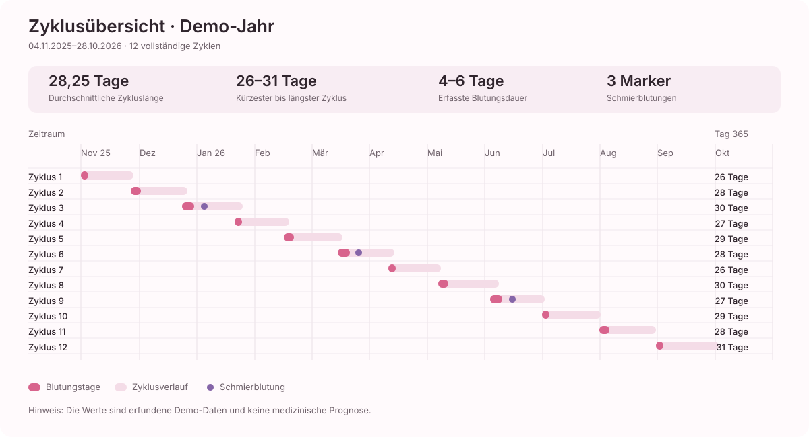

## Vorschau und Auswertungen

Zyklus-Vorschau und Symptomhäufigkeiten sind abgeleitete Ergebnisse, keine zusätzlichen eingegebenen
Gesundheits-Entities. Sie werden aus vorhandenen Einträgen berechnet. Vorschau bei zu wenigen Daten
nicht anzeigen; keine echte Prognose behaupten.

## Grafische Zyklusübersicht für Linear

Die Jahresdarstellung basiert auf den erfundenen Demo-Daten aus
`lib/debug/cycle_demo_data.dart`. Sie zeigt zwölf vollständige Zyklen vom 04.11.2025 bis zum
28.10.2026 auf einer gemeinsamen Zeitachse.

### Lesart

- Der hellrosa Balken zeigt die Dauer des jeweiligen Zyklus.
- Der dunklere pinke Abschnitt markiert die erfassten Blutungstage.
- Ein violetter Punkt markiert eine Schmierblutung.
- Die Zahlen rechts zeigen die jeweilige Zykluslänge.

### Demo-Zusammenfassung

| Kennzahl | Wert |
| --- | ---: |
| Vollständige Zyklen | 12 |
| Durchschnittliche Zykluslänge | 28,25 Tage |
| Kürzester Zyklus | 26 Tage |
| Längster Zyklus | 31 Tage |
| Erfasste Blutungsdauer | 4–6 Tage |
| Schmierblutungs-Ereignisse | 3 |

Die Grafik ist als SVG gespeichert und kann direkt in eine Linear-Beschreibung oder ein
Markdown-Dokument übernommen werden. Die Demo-Werte sind ausschließlich zur Darstellung gedacht.
