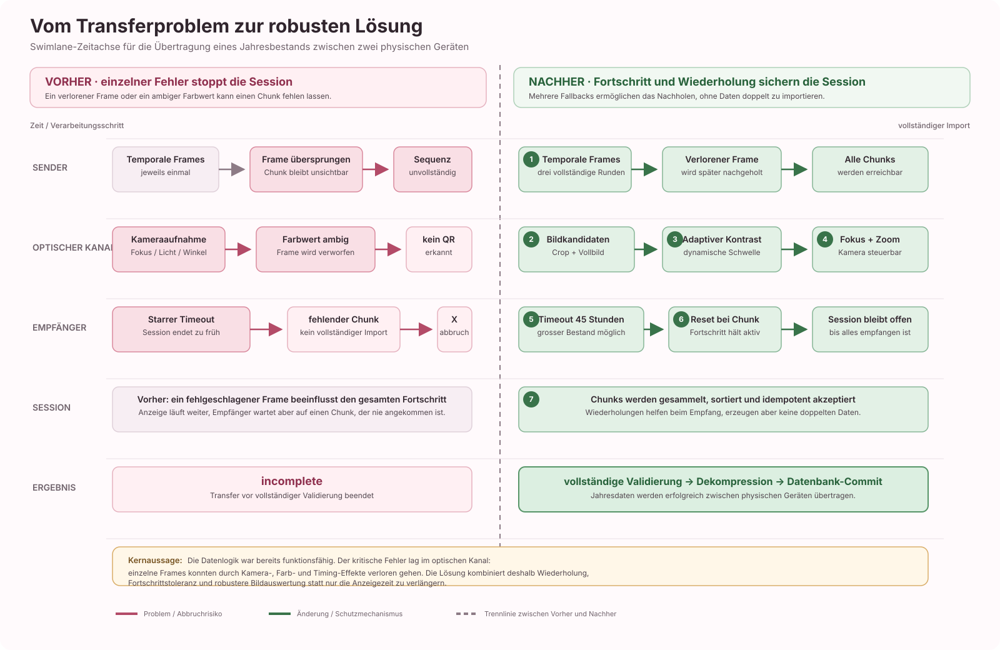

# MLQR: Erzeugung und Kameraempfang

## Testen

Die frühere separate MLQR-Demo-Startdatei wurde entfernt. MLQR wird jetzt nur
noch innerhalb der vollständigen Zyklus-Demo getestet:

```sh
flutter run -t lib/main_cycle_demo.dart
```

Für reine Encoder- und Decoder-Prüfungen werden die automatisierten Tests
verwendet. Sie verwenden feste UTF-8-Testtexte und keine echten Gesundheitsdaten.
In der normalen App kann „Datentransfer → Von diesem Gerät senden“ eine
komprimierte Snapshot-Sequenz ohne Passphrase erzeugen. Die Chunks werden auf
mehrere MLQR-Bilder verteilt und automatisch weitergeschaltet. „Auf diesem Gerät
empfangen“ öffnet den Kamera-Scanner; vollständige MLQR-Codes werden erkannt,
ihre Chunks sitzungsbezogen gesammelt und erst nach vollständiger Prüfung in die
lokale Datenbank übernommen.

Im Debug-Modus gibt es in der Transferübersicht zusätzlich den aufklappbaren
Bereich „Ergebnisansichten testen“. „Erfolg ansehen“ und „Fehler ansehen“ öffnen
die gekennzeichneten Ergebnisvorschauen. Übertragungsdetails zeigen Beispielwerte;
„Zur Übersicht“ kehrt zurück. „Erneut versuchen“ öffnet einen neuen Kamerascan. Der Sendebildschirm wechselt
nicht automatisch auf einen erfundenen Erfolg.

Die Ergebnisansicht erhält einen `TransferResultViewModel` mit
`TransferCodeRead`, `TransferSucceeded` oder `TransferFailed`. Der spätere Empfänger darf Erfolg
erst nach Datenprüfung und erfolgreichem Datenbank-Commit melden; aufgeführt
werden nur die übergebenen `importedCategories`. Fehler setzen voraus, dass
keine Änderungen übernommen wurden beziehungsweise ein Rollback abgeschlossen
ist. Unvollständige, unlesbare, nicht verifizierbare und nicht speicherbare
Übertragungen haben eigene Meldungen. Die Ansicht liefert `overview` oder
`retry` als Navigationsergebnis an ihren Aufrufer zurück. Diese UI-Schnittstelle
implementiert selbst weder Datenprüfung noch Import.

## Quelle und Abgrenzung

Eigenständige Implementierung nach Noppakaew, Khomkuth und Sriwilas (2018),
*Construction of multi-layered QR codes utilizing partitions of positive integers*,
Abschnitte 2.1–2.4, DOI: https://doi.org/10.22436/jmcs.018.03.06.
Das lokale Paper liegt unter `assets/refer/`. Es wurde kein Code aus der früheren
praktischen Vorarbeit übernommen. Code und diese Dokumentation wurden mit
Unterstützung von Codex erstellt.

Implementiert sind Erzeugung, digitaler Decoder, Kamerapfad und eine
sequenzielle Chunk-Sammlung. Ein einzelner MLQR-Code wird weiterhin als
untrennbare optische Einheit dekodiert; einzelne Farblayer werden nicht separat
über die Kamera übertragen.
Die Grenze von 15 Ebenen ist ein Implementierungslimit in Anlehnung an das Paper,
kein Nachweis für Kameratauglichkeit.

Das Format verhindert weder Fotografieren noch die Implementierung eines
anderen MLQR-Decoders. Die Testtexte sind unverschlüsselt. Vertraulichkeit muss
vor der Verwendung echter Gesundheitsdaten durch authentifizierte
Transfer-Verschlüsselung abgesichert werden, nicht durch die Unlesbarkeit mit
einer gewöhnlichen Scanner-App.

## Schnittstelle und Berechnung

`MlqrEncoderService.encode(List<Uint8List>, {padWithDummies: true})` erzeugt pro
Paket eine QR-Ebene. Es findet keine automatische Paketaufteilung statt.
Binärdaten werden direkt im Byte-Modus kodiert, ohne Base64 oder Textumwandlung.
Leere Byte-Pakete sind erlaubt; eine leere Paketliste ist ungültig.

Die reine Dart-Bibliothek `qr` übernimmt die Standard-QR-Kodierung inklusive
Reed-Solomon-Fehlerkorrektur M. Alle Ebenen erhalten die kleinste gemeinsam
passende QR-Version (1–40). Jede Ebene darf ihre eigene QR-Maske verwenden.
Zu grosse Pakete werden als `FormatException` zurückgewiesen.

Für k Nutzdatenebenen gilt l = ceil(k/3), s = floor(255/(2^l−1)). Die ersten
l−1 Gewichte sind s·2^i; das letzte ergänzt auf 255. Für l=1 gilt [255].
Dies ist eine gemeinsame Partition für alle drei Kanäle.

Die Ebenenreihenfolge ist fest: Rot, Grün, Blau, jeweils aufsteigende Gewichte.
Beispiel k=7: R36, R72, R147, G36, G72, G147, B36. Das entspricht Beispiel 3.1
des Papers. Beispiel 2.4 enthält beim letzten Farbvektor offenbar einen
Druckfehler; seine rote Wiederholung wird nicht übernommen.

Standardmässig werden Dummys bis zu 3·l Ebenen angehängt. Sie sind weiss bis
auf die drei 7×7-Positionsmuster. Sie sind keine dekodierbaren Nutzdaten-QRs.
Sie bekommen die noch freien Gewichte; bei sieben Paketen also B72 und B147.
Mit `padWithDummies: false` entsteht die ungepolsterte Paper-Variante.

`QrModuleMatrix` verwendet true für Schwarz. Im Encoder trägt dagegen nur ein
weisses Modul sein Gewicht zum Kanal bei. Gewichte werden addiert, ohne
Transparenz, Mittelwertbildung oder Farbraumtransformation.

`compose` bietet dieselbe Überlagerung für bereits vorhandene binäre Matrizen.
Alle Matrizen müssen quadratisch und gleich gross sein. Für Dummy-Ergänzung
wird ein Raster ab 21 Modulen vorausgesetzt. Dieser Einstieg prüft keine
QR-Syntax und liefert deshalb keine QR-Versionsnummer.

## Ergebnis und Darstellung

`MlqrCode` enthält das unveränderte Kernraster, ein dekoriertes Anzeigeraster,
QR-Version, Nutzdatenanzahl, Partition sowie Ebenen mit Matrix, Kanal, Gewicht
und Paketindex. Ein fehlender Paketindex kennzeichnet einen Dummy. Listen sind
unveränderlich; RGB-Pixel sind als 0xRRGGBB gespeichert.

Der Kern beginnt im Anzeigeraster bei Spalte 5 und Zeile 4 (nullbasiert).
Seine Ruhezone ist ringsum vier Module breit. Links ausserhalb der Ruhezone
liegt in Spalte 0 der ein Modul breite Referenzbalken, beginnend auf Höhe der
ersten Kernzeile. Seine Farben wechseln Grün, Blau, Rot; die Kästchenzahl
entspricht allen optischen Ebenen inklusive Dummys. Das ist eine ausdrücklich
festgelegte Layoutvariante mit intakter QR-Ruhezone, keine pixelgenaue Kopie der
Paper-Abbildung. Der Kamera-Decoder verwendet genau diese Geometrie.

Der Balken transportiert noch keine Nutzdatenanzahl oder Protokollversion.
Der aktuelle Decoder erkennt ausschliesslich das exakte Dummy-Muster des
Encoders und erlaubt höchstens zwei Dummys am Ende. Die Chunk-Anzahl und
Protokollversion werden deshalb nicht aus dem Balken, sondern aus den
Transfer-Chunk-Metadaten gelesen.

`MlqrRasterView` zeichnet vorbereitete Pixel ohne Kantenglättung und mit
ganzzahliger physischer Modulgrösse. Der ViewModel koordiniert Testdaten und
Encoder. Die Berechnung selbst importiert weder Flutter noch UI-Code.

## Prüfung

```sh
flutter test test/mlqr_encoder_test.dart test/mlqr_demo_test.dart
dart analyze lib test integration_test
```

Die Tests prüfen die Paper-Partitionen, eindeutige Teilmengensummen,
handberechnete Farbwerte, das Sieben-Ebenen-Beispiel, Dummys und Referenzbalken,
gemeinsame QR-Versionen, rohe Bytes und Kapazitätsgrenzen. Die Anzeige lässt
sich zusätzlich als temporäres Bild für die Sichtprüfung erfassen:

```sh
MLQR_PREVIEW_PATH=/tmp/mlqr-preview.png flutter test test/mlqr_demo_test.dart
```

Für lesbaren Text statt der Flutter-Testschrift kann zusätzlich
`MLQR_PREVIEW_FONT` auf eine lokal vorhandene TTF-Schrift gesetzt werden.

Prüfstand 18.10.2026: Alle 13 neuen MLQR-Tests bestehen. Die neuen Dart-Dateien
sind ohne Analyzer-Befund; projektweit bleiben 13 vorhandene Stilhinweise.
Die gesamte Unit-/Widget-Suite liefert 53 erfolgreiche und vier fehlgeschlagene
Tests. Dieselben vier Fehler wurden separat am unveränderten Git-Stand
`db7eb7b` reproduziert: zwei Home-Tests und der Startup-Test laufen bei
`pumpAndSettle` in einen Timeout; der alte JSON-Speichertest erwartet weiterhin
Schema 1 statt des aktuellen Schema 2. Sie wurden in dieser Änderung nicht
bearbeitet. Die Debug-Darstellung wurde als Widget gerendert und visuell
geprüft; ein Hardware-Kameratest ist noch nicht erfolgt.

## Kamera-Scanner

Die Haupt-App öffnet unter „Datentransfer → Auf diesem Gerät empfangen“ den
Scan-Screen: Zurück-Pfeil, Livebild der rückseitigen Kamera, Scanrahmen und
Abbruch. Der Rahmen dient nur der Orientierung; ausgewertet wird das gesamte
Bild. Code, Ruhezone und Referenzbalken müssen vollständig sichtbar sein.
Die Kamera wird beim Verlassen oder beim Hintergrundwechsel freigegeben.
Bei Rückkehr startet eine neue Sitzung; verspätete Ergebnisse einer alten
Sitzung werden ignoriert. Die Standardsitzung läuft bis zu 45 Stunden. Dieser
lange Zeitraum ist für grosse Bestände gedacht, insbesondere für ein ganzes
Jahr zyklischer Daten über physische Geräte. Ein unlesbares Einzelbild beendet
den Scan nicht.

`MlqrCameraSource` kapselt die native Kamera. Das Paket `camera` liefert rohe
Farbbilder, auch wenn ein Standard-Barcode-Scanner den MLQR nicht erkennt.
BGRA8888 (iOS) und dreiplanares YUV420 (Android) werden unter Berücksichtigung
der Zeilen- und Pixelabstände in RGB umgerechnet. Es wird kein Audio
aufgenommen; Bilder werden weder als Dateien abgelegt noch hochgeladen.
Bis zu zwei Bilder pro Sekunde werden übernommen; maximal eine Dekodierung
läuft gleichzeitig in einem Isolate. Die längste Bildseite wird auf maximal
1280 Pixel reduziert, was bei sehr kleinen Modulen die Lesbarkeit begrenzt.

`MlqrDecoderService.decodeRaster(core, opticalLayerCount: ...)` rekonstruiert
mit den Teilmengensummen der Paper-Partition die Schwarzweissmatrizen.
`decodeImage(image)` sucht zunächst die Positionsmuster, berechnet die
Abbildung auf das Modulraster, liest den Referenzbalken und normalisiert die
Kanäle anhand des schwarzen Positionsmusters und der weissen Ruhezone.
Dies ist eine einfache kanalseparate Farbkorrektur, keine allgemeine
Kalibrierung für beliebige Kameras, Reflexionen oder Farbmischungen.

Der isolierte `MlqrQrAdapter` verwendet `zxing2` 0.2.4 für Lokalisierung,
Standard-QR-Dekodierung und deren Reed-Solomon-Fehlerkorrektur. Die Version ist
fixiert, weil die Bibliothek die benötigten Matrix-APIs nur intern exportiert.
Zurückgegeben werden die QR-Byte-Segmente, nicht die QR-Datencodewörter oder
ein verlustbehaftet dekodierter Text. Alle Nutzdatenebenen müssen dekodierbar
sein. Mehrdeutige Farben, fehlende Referenzen oder beschädigte Ebenen führen
zu keinem Erfolg; Standard-QR ohne Referenzbalken wird nicht akzeptiert.

### Robustheit der physischen Geräteübertragung

Die erfolgreiche Übertragung eines Jahresbestands zwischen physischen Geräten
beruht nicht nur auf der verlängerten Scanzeit. Die im Commit
`faaaf05fef2db990a32615d1bb74b6f747723ad5` eingeführte Lösung kombiniert
mehrere Sicherungen:

- **Wiederholung der temporalen Daten:** Die vollständige temporale QR-Sequenz
  wird drei Mal angezeigt. Verlorene oder zu spät dekodierte Kameraframes
  können dadurch in einer späteren Runde erneut gelesen werden.
- **Fortschrittsbasierter Timeout:** Nach jedem neu akzeptierten Chunk wird der
  Timeout neu gestartet. Die Übertragung läuft weiter, solange tatsächlich
  Fortschritt eintrifft.
- **Zwei Bildkandidaten:** Der Empfänger versucht zuerst einen zentrierten
  Ausschnitt des Kamerabilds und danach das vollständige Bild. Beide Varianten
  werden normal und temporal dekodiert.
- **Adaptive Kontrastauswertung:** Die QR-Lokalisierung probiert Luminanz,
  Min-/Max-Farbkanal und Kontrastnormalisierung. Beim temporalen Decoder wird
  die Schwarz-Weiss-Schwelle aus dem 10. und 90. Perzentil des aktuellen Bildes
  berechnet. Displays, deren Schwarz nicht vollständig dunkel erscheint,
  bleiben dadurch lesbar; Bilder mit praktisch keinem Kontrast werden dagegen
  verworfen.
- **Kamerasteuerung:** Fokus und Belichtung werden automatisch konfiguriert.
  Durch Antippen kann der Empfänger zusätzlich auf eine Stelle fokussieren;
  falls das Gerät Zoom unterstützt, steht ein Zoom-Slider zur Verfügung.

Die temporale Wiederholung ist besonders wichtig für Jahresdaten: Sie macht
die Übertragung langsamer, reduziert aber die Abhängigkeit von einzelnen
verlorenen Frames und vermeidet bei der temporalen Darstellung die engen
Farbabstände der stark belegten 15-Layer-MLQR-Codes. Die Übertragung benötigt
keinen Rückkanal zwischen Sender und Empfänger.

### Praktische Grenze der 15 Ebenen

Die Ebenen werden bei jedem MLQR tatsächlich in den drei RGB-Kanälen gestapelt.
Die Grenze von 15 Ebenen ist deshalb keine fehlende Überlagerung, sondern eine
Grenze der optischen Trennbarkeit. Bei 15 Ebenen verwendet die Partition
`[8, 16, 32, 64, 135]`; die kleinste Teilmengensumme liegt damit nur acht
RGB-Werte auseinander. Der Kamera-Decoder akzeptiert in diesem Fall bewusst nur
eine Abweichung von höchstens `3,5` RGB-Werten zur nächstgelegenen gültigen
Summe.

Bei kleineren Transfers, zum Beispiel zwei Monaten, entstehen oft nur wenige
Chunks und Ebenen. Die Farbabstände sind dann größer: Bei drei Ebenen lautet
die Partition beispielsweise `[36, 72, 147]`, die Toleranz beträgt `17,5`.
Deshalb ist der Kameraempfang in diesem Fall stabiler. Bei einem Jahresbestand
werden dagegen häufig 15 Ebenen gefüllt. Der erzeugte Code kann mathematisch
korrekt sein und auf dem Display vollständig erscheinen, während Beleuchtung,
Display- und Kameraabweichungen, Reflexionen, Skalierung sowie Kompression die
gemessenen RGB-Werte stärker verschieben als die erlaubte Toleranz. Eine Ebene
ist dann nicht mehr eindeutig erkennbar. Der Decoder verwirft den gesamten Code;
fehlt dadurch ein Chunk, wird die Transfersession nicht importiert.

Die adaptive QR-Größenwahl begrenzt inzwischen die QR-Version standardmässig auf
Version 10. Dadurch werden die QR-Module auf dem Display grösser und die
Jahresdaten werden auf mehrere MLQR-Bilder verteilt. Sie beseitigt jedoch nicht die enge Farbstufung
bei 15 Ebenen. Für eine robuste Hardwareübertragung muss die Layer-Anzahl daher
künftig adaptiv gewählt werden: bis zu 15 Ebenen bei ausreichender
Farbtrennbarkeit, ansonsten 9 oder 7 Ebenen und entsprechend mehr MLQR-Bilder.
Das erhöht die Bildanzahl, kann aber die zuverlässige Übertragung eines Jahres-
oder Mehrjahresbestands ermöglichen.

Ein empfangener MLQR-Code wird zunächst vollständig dekodiert. Die darin
enthaltenen Chunks werden anhand von `transferId`, `index` und `total` in einem
flüchtigen `TransferChunkAccumulator` gesammelt. Identische Duplikate sind
idempotent; widersprüchliche Wiederholungen werden abgelehnt. Während der
Sammlung zeigt die Empfangsansicht den Fortschritt und die fehlenden Chunks.
`TransferSucceeded` wird erst nach vollständiger Sequenz, Dekompression,
CBOR-Deserialisierung und erfolgreichem Datenbank-Commit erzeugt. Bei Abbruch,
Timeout oder Abschluss werden die temporären Chunks aus dem Arbeitsspeicher
entfernt.

### Temporale Layer als Fallback

Jeder Nutzdatenlayer enthält bereits einen vollständigen QR-Code mit einem
kompletten `TransferChunk`. Deshalb kann die Anwendung zusätzlich eine temporale
Sequenz erzeugen: Sie zeigt die vorhandenen Layer nacheinander als einzelne
Schwarzweiss-QR-Codes an. Der Empfänger versucht nach einem fehlgeschlagenen
farbigen MLQR-Scan automatisch, den aktuellen Kameraframe als normalen QR-Code
zu dekodieren. Die Chunk-Metadaten bleiben unverändert; `transferId`, `index`
und `total` ordnen die Layer wieder der Transfersession zu.

Der Sender zeigt zunächst die farbigen MLQR-Codes und anschliessend die
temporalen Layer. Diese komplette Sequenz wird standardmässig drei Mal
gesendet. Dadurch können einzelne verlorene Kameraframes nachgeholt werden,
ohne einen Rückkanal zwischen den Geräten einzuführen. Die Methode ist
langsamer, vermeidet aber die engen RGB-Abstände der 15-Layer-Darstellung und
kann auch mit einem gewöhnlichen Schwarzweiss-QR-Reader grundsätzlich erkannt
werden.

Jeder erkannte Chunk setzt beim Empfänger den laufenden Scan-Timeout zurück.
Duplikate werden vom `TransferChunkAccumulator` idempotent behandelt; die
dreifache Anzeige führt daher nicht zu mehrfach importierten Daten.

### Ergebnis des Hardwaretests

Die Übertragung eines ganzen Jahres zyklischer Daten zwischen physischen
Geräten ist mit der Lösung aus Commit
`faaaf05fef2db990a32615d1bb74b6f747723ad5` erfolgreich möglich. Der Transfer
kann länger dauern als ein kleiner Testtransfer, bleibt aber aktiv, solange
neue Chunks eintreffen. Die temporale Sequenz wird mehrfach angezeigt und
fehlende Kameraframes können dadurch nachgeholt werden. Wiederholte Chunks
werden nur für den Fortschritt berücksichtigt und nicht nochmals importiert.

Für die Fehlersuche sind weiterhin die empfangene Chunk-Anzahl und die
erwartete Chunk-Anzahl massgeblich. Ein vollständiger Erfolg wird erst nach
vollständiger Dekodierung, Dekompression, Deserialisierung und Datenbank-Commit
gemeldet.

Die folgende Grafik zeigt die Ursache-Wirkungs-Kette als Vorher-Nachher-
Zeitachse. Sie macht sichtbar, dass die verlängerte Scanzeit allein nicht die
Lösung war: Erst die Kombination aus Wiederholung, Timeout-Fortschritt,
robusterer Bildauswertung und Kamerasteuerung verhindert den Abbruch durch
einzelne verlorene Frames.



**Abbildung:** Vorher-Nachher-Swimlane des physischen MLQR-Transfers. Rot
markiert den früheren Abbruchpfad, Grün die im Commit
`faaaf05fef2db990a32615d1bb74b6f747723ad5` eingeführten
Schutzmechanismen. Die wiederholten Chunks werden durch den Accumulator
idempotent behandelt und deshalb nicht doppelt importiert.

Die Darstellung folgt der üblichen wissenschaftlichen Praxis, eine Abbildung
im Text anzukündigen, mit einer eigenständigen Legende zu versehen und die
wichtigste Aussage im Fliesstext zu erklären. Farben werden nicht allein als
Informationsträger verwendet; Linien, Überschriften und die Vorher-Nachher-
Trennung tragen dieselbe Bedeutung. Als Gestaltungsreferenzen dienen die
[Hinweise zu wissenschaftlichen Abbildungen von Purdue OWL](https://owl.purdue.edu/owl/research_and_citation/apa_style/apa_formatting_and_style_guide/apa_tables_and_figures.html)
und die [W3C-Hinweise zu Kontrast in Texten und Grafiken](https://www.w3.org/WAI/WCAG21/understanding/non-text-contrast.html).

### Prüfung des Empfangs

```sh
flutter test test/mlqr_decoder_test.dart test/transfer_receive_test.dart test/transfer_result_test.dart test/transfer_send_test.dart test/mlqr_encoder_test.dart test/navigation_test.dart
dart analyze lib test integration_test
```

Automatisiert geprüft werden rohe Bytes für 1–15 Ebenen mit/ohne Dummys,
Lokalisierung in synthetischen gedrehten und farbveränderten Bildern,
Referenzbalken, beschädigte Ebenen, BGRA-/YUV-Strides, der Isolate-Pfad,
Navigation, Berechtigungsfehler, Timeout und Freigabe der Kamera.
Diese Prüfungen ersetzen keinen Display-zu-Kamera-Test mit echten Smartphones.
Insbesondere die zuverlässige Kameraerkennung von 15 Ebenen ist nicht belegt.

Für einen Gerätetest die App vollständig stoppen und neu bauen (`flutter run`
auf dem gewählten Smartphone). Hot Reload integriert die neue native
Kamera-Bibliothek nicht. Auf Gerät A die Sendeseite öffnen, auf Gerät B den
Empfang wählen und die Kamerafreigabe bestätigen. Erwartet werden ein Livebild,
die drei ursprünglichen Testpakete und keine importierten Gesundheitsdaten.
Anschliessend Abbruch, verweigerte Freigabe, Hintergrundwechsel und erneuten
Versuch prüfen. Der Hardwaretest mit einem Jahresbestand wurde erfolgreich
durchgeführt; die Übertragung kann jedoch weiterhin deutlich länger dauern als
ein kleiner Testtransfer.

Nächster Meilenstein: weitere Messungen der Kamera-Lesbarkeit unter
unterschiedlichen Display-, Licht-, Abstand- und Winkelbedingungen. Die
digitale Jahresdatensatz-Prüfung, die sequenzielle Chunk-Rekonstruktion und die
Übertragung zwischen physischen Geräten sind nach dem aktuellen Hardwaretest
nachgewiesen; eine statistische Erfolgsrate über viele Gerätekombinationen ist
noch nicht erhoben.

Prüfstand Kamera-Screen: Die 32 betroffenen Encoder-, Decoder-, Empfangs-,
Sende-, Ergebnis- und Navigationstests bestehen nach der Layoutkorrektur
(die Empfangstests wurden gezielt erneut ausgeführt). Die neuen/geänderten
Dart-Dateien haben keine Analyzer-Befunde; projektweit verbleiben die
13 bestehenden Stilhinweise. Die Startansicht wurde gerendert und visuell
geprüft, zusätzlich bei 320 Pixeln Breite mit 1,5-facher Textgrösse getestet.

Die native iOS-Kamera-Einbindung kompiliert mit folgendem ARM64-Simulator-Build:

```sh
xcodebuild -workspace ios/Runner.xcworkspace -scheme Runner -configuration Debug \
  -sdk iphonesimulator -destination 'generic/platform=iOS Simulator' \
  ARCHS=arm64 ONLY_ACTIVE_ARCH=YES CODE_SIGNING_ALLOWED=NO build
```

Der allgemeine `flutter build ios --simulator --debug` scheitert in dieser
lokalen Toolchain in `debug_unpack_ios` bei der Prüfung von `arm64 x86_64`,
obwohl `lipo -info` beide Architekturen meldet. Der gezielte ARM64-Build ist
erfolgreich. Es wurden dafür keine dauerhaften Architektur-Einstellungen
im Projekt geändert. Android-Build und echte Smartphone-Scans wurden hier
noch nicht verifiziert.
