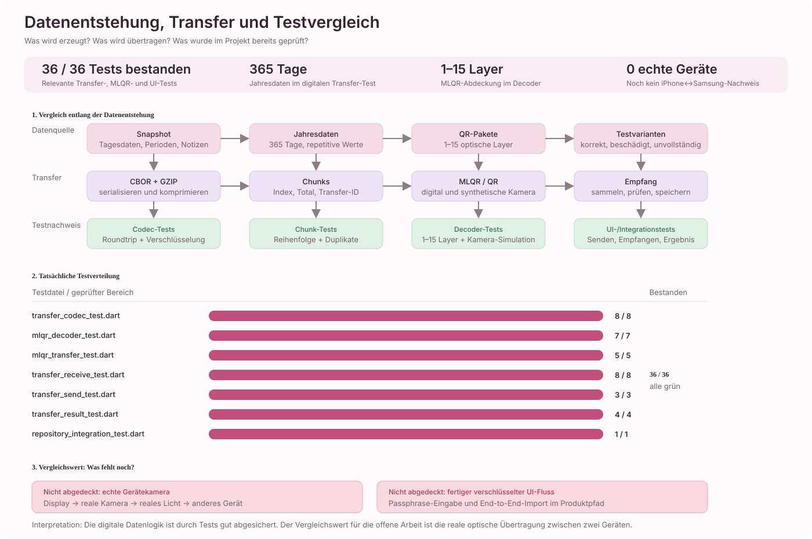
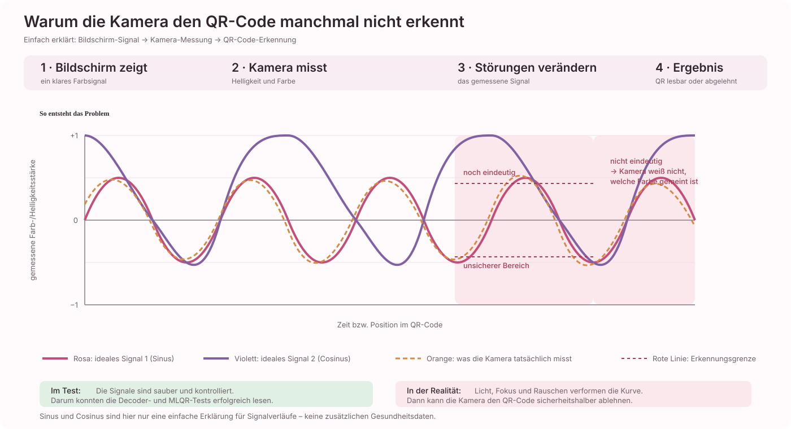
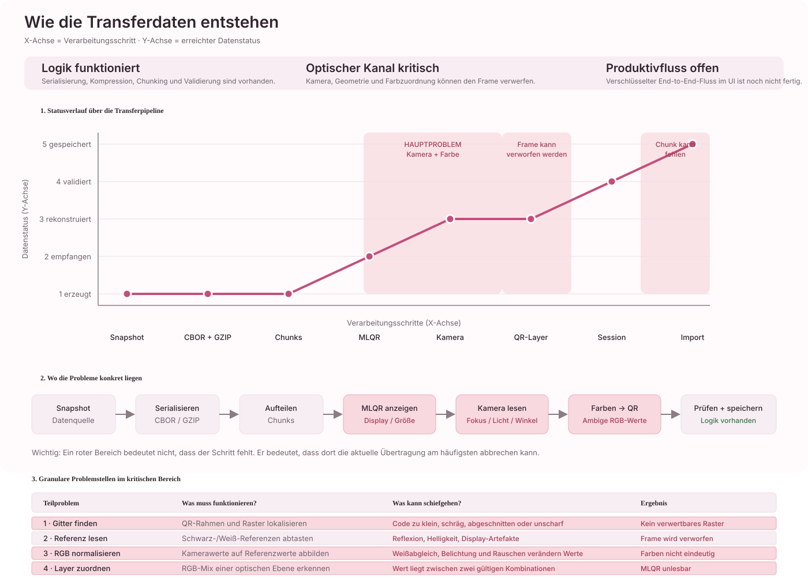

# Bericht: Warum der Datentransfer aktuell noch nicht zuverlässig funktioniert

**Stand:** 25. Oktober 2026  
**Bereich:** Optischer Datentransfer zwischen zwei mobilen Geräten  
**Projekt:** Regelmässig

## Kurzfassung

Die Übertragung scheitert nach aktuellem Stand hauptsächlich an der **robusten optischen Erkennung des farbigen Multi-Layer-QR-Codes durch eine reale Kamera**.

Die logische Datenpipeline ist im Repository bereits weitgehend vorhanden und wird durch Unit- und Integrationstests abgedeckt:

1. Ein `TrackingSnapshot` wird serialisiert.
2. Die Daten werden mit GZIP komprimiert.
3. Der komprimierte Inhalt wird in Transfer-Chunks geteilt.
4. Die Chunks werden als mehrere QR-Ebenen in einem farbigen MLQR dargestellt.
5. Der Empfänger versucht, die Kameraaufnahme wieder in einzelne QR-Ebenen und anschließend in Transfer-Chunks zurückzuführen.
6. Erst wenn alle Chunks vollständig und konsistent vorliegen, werden sie dekodiert, validiert und gespeichert.

Der kritische Übergang ist Schritt 5. Der Decoder muss aus einem realen Kamerabild exakt rekonstruieren, welche Farbinformation ursprünglich auf dem Bildschirm angezeigt wurde. Beleuchtung, Weißabgleich, Belichtung, Fokus, Perspektive, Display-Artefakte und Kompression verändern die Pixelwerte. Der aktuelle Decoder ist bewusst konservativ: Bei nicht eindeutig trennbaren Farben verwirft er den Frame, statt einen möglicherweise falschen Datenwert zu raten.

Das bedeutet: **Die Daten können im Code bereits logisch verarbeitet werden; der reale Bildschirm-zu-Kamera-Kanal ist noch nicht ausreichend robust.**

## 1. Zielarchitektur

Der Transfer soll ohne Server, Cloud oder Konto funktionieren. Gerät A zeigt Daten optisch an, Gerät B liest sie mit der Kamera ein. Die Daten verlassen das Gerät nur über den Bildschirm-zu-Kamera-Kanal.

Die fachlichen Daten und die technischen Transferdaten sind getrennt. Die Transfermodelle beschreiben unter anderem `transferId`, Chunk-Index, Gesamtanzahl, Sicherheitsmodus und Nutzdaten. Siehe `docs/Entities/transferModelleEntry.md`.

Der physische Kanal besteht aus zwei möglichen Darstellungen:

- **MLQR:** Mehrere QR-Ebenen werden in einem farbigen Bild gebündelt.
- **Temporaler Fallback:** Einzelne schwarz-weisse QR-Layer werden nacheinander angezeigt.

Die Sendeseite erzeugt diese Sequenz in `lib/services/mlqr_transfer_service.dart` und zeigt sie über `lib/viewmodels/transfer_send_view_model.dart` und `lib/views/transfer/transfer_send_view.dart` an. Die Empfangsseite verarbeitet Kameraframes über `lib/viewmodels/transfer_receive_view_model.dart`.

## 2. Was bereits funktioniert

### 2.1 Logische Kodierung und Chunking

`TransferCodec` serialisiert einen Snapshot, komprimiert ihn und teilt ihn in Chunks. Die Chunks enthalten unter anderem:

- Transfer-ID
- Protokollversion
- Chunk-Index
- Gesamtanzahl der Chunks
- optional Salt und Nonce
- Payload beziehungsweise Ciphertext
- optionalen MAC

Die Chunk-Struktur wird beim Empfang validiert. Chunks mit falscher Transfer-ID, falscher Gesamtanzahl, falscher Version oder widersprüchlichen doppelten Indizes werden abgelehnt.

Belege:

- `lib/services/transfer_codec.dart`, Klassen `TransferChunk` und `TransferChunkAccumulator`
- `test/transfer_codec_test.dart`
- `test/transfer_repository_integration_test.dart`

### 2.2 Zusammensetzen einer Transfersession

`TransferChunkAccumulator` sammelt Chunks unabhängig von ihrer Empfangsreihenfolge. Identische Wiederholungen werden ignoriert. Die Session gilt erst als vollständig, wenn alle erwarteten Indizes vorhanden sind.

Das ist für den optischen Kanal notwendig, weil ein Bild mehrfach gelesen werden kann oder einzelne Bilder in einer anderen Reihenfolge eintreffen können.

Belege:

- `lib/services/transfer_codec.dart`, Methode `acceptAll`
- `test/transfer_codec_test.dart`, Tests zu Reihenfolge, Duplikaten und fehlenden Chunks

### 2.3 MLQR-Erzeugung

`MlqrTransferService` bündelt bis zu sieben Nutzdaten-Layer pro angezeigtem MLQR. Bei größeren Transfers entstehen mehrere MLQR-Codes. Zusätzlich werden temporale schwarz-weisse Frames erzeugt.

Die QR-Größe wird über eine Zielversion begrenzt. Die Sendeseite kann die Anzahl der Codes, Chunks, Layer und Payload-Größen anzeigen.

Belege:

- `lib/services/mlqr_transfer_service.dart`
- `lib/viewmodels/transfer_send_view_model.dart`
- `lib/views/transfer/transfer_send_view.dart`
- `test/mlqr_transfer_test.dart`

### 2.4 Import erst nach vollständiger Validierung

Auf der Empfängerseite wird der Snapshot erst nach folgenden Schritten gespeichert:

1. alle Chunks empfangen
2. Payload zusammenführen
3. Dekompression und Deserialisierung
4. Snapshot validieren
5. bestehenden Snapshot zusammenführen
6. Repository speichern

Damit ist ein unvollständiger oder beschädigter Transfer nicht automatisch ein teilweise importierter Transfer.

Beleg:

- `lib/viewmodels/transfer_receive_view_model.dart`, Methode `_acceptTransferCode`

## 3. Das konkrete aktuelle Problem

### 3.1 Der kritische Kanal ist die Kameraauswertung

Die Empfangslogik erhält keine bereits bereinigte QR-Matrix, sondern reale Kameraframes. Aus jedem Frame muss zunächst ein QR-Gitter gefunden und anschließend jedes Modul farblich abgetastet werden.

Der Ablauf in `MlqrDecoderService.decodeImage` ist:

1. mögliche QR-Gitter im Kamerabild lokalisieren
2. Schwarz- und Weiss-Referenzpunkte abtasten
3. jeden RGB-Wert anhand dieser Referenzen normalisieren
4. den Referenzbalken lesen und die Layeranzahl bestimmen
5. jedes Modul des QR-Rasters abtasten
6. die RGB-Werte über eine Subset-Sum-Zuordnung einzelnen optischen Layern zuordnen
7. jede rekonstruierte Ebene als normalen QR-Code dekodieren

Jeder dieser Schritte kann durch eine reale Kameraaufnahme beeinflusst werden.

### 3.2 Farbwerte sind in der Realität nicht stabil

Der MLQR-Decoder erwartet, dass die aus dem Kamerabild gewonnenen Farbwerte eindeutig einer Kombination optischer Ebenen zugeordnet werden können. Dafür wird je Farbkanal eine Lookup-Tabelle mit zulässigen Werten und einer Toleranz verwendet.

Im Decoder gilt ausdrücklich:

```dart
// Never accept a value on/beyond half the minimum subset spacing.
// This is deliberately conservative; no guesses across ambiguous bins.
```

Wenn ein Kamerawert zwischen zwei möglichen Kombinationen liegt oder zu weit vom erwarteten Wert entfernt ist, wird der Frame abgelehnt. Das ist sicherer als ein falsches Datenbit, reduziert aber die Erkennungsrate.

Typische Ursachen für solche Abweichungen sind:

- warmes oder ungleichmäßiges Umgebungslicht
- Reflexionen auf dem Display
- automatische Farbkorrektur und automatischer Weissabgleich
- automatische Belichtungsanpassung
- unterschiedliche Displaytechnologien und Helligkeitsprofile
- zu geringe Bildschirmhelligkeit
- Überbelichtung einzelner Farbkanäle
- Kamerarauschen oder Bewegungsunschärfe
- Skalierung des Bildes durch die Kamera-Pipeline

Beleg:

- `lib/services/mlqr_decoder_service.dart`, Methode `decodeImage`
- Fehlermeldungen `Zu wenig Farbkontrast` und `Farben sind nicht eindeutig trennbar`

### 3.3 Geometrie und Bildqualität können die QR-Lokalisierung verhindern

Bevor Farben dekodiert werden, muss das QR-Gitter im Kamerabild gefunden und korrekt ausgerichtet werden. Bei schrägem Blickwinkel, zu geringem Abstand, abgeschnittenem Code oder Unschärfe kann die QR-Lokalisierung scheitern.

Dann wird kein verwertbares Raster erzeugt, selbst wenn die Daten auf dem Bildschirm korrekt dargestellt werden.

Mögliche Auslöser:

- Code nicht vollständig im Kamerabild
- zu kleine Darstellung auf dem Sendegerät
- schräger Winkel zwischen beiden Geräten
- Kamerafokus noch nicht stabil
- Bewegungsunschärfe während des Frame-Wechsels
- Display- oder Kameraauflösung passt ungünstig zur QR-Modulgröße
- sichtbare Skalierungs- oder Moiré-Muster

Der aktuelle Kamera-Decoder sucht im gesamten Originalframe. Die UI stellt zwar eine Ausrichthilfe bereit, diese begrenzt die Dekodierung aber nicht auf einen technisch zugeschnittenen Bereich.

Beleg:

- `lib/services/mlqr_decoder_service.dart`, Methode `decodeImage`
- Kommentar in `lib/views/transfer/transfer_receive_view.dart`: Die Ausrichthilfe ist nur visuell; der Decoder durchsucht weiterhin das gesamte Kamerabild.

### 3.4 Ein einzelner fehlgeschlagener Layer verwirft den gesamten MLQR

Ein MLQR enthält mehrere QR-Layer. Wenn eine rekonstruierte Ebene nicht als normaler QR-Code gelesen werden kann, wird der aktuelle Decoderlauf abgebrochen. Dadurch kann ein einzelnes fehlerhaftes Modul oder ein einzelner fehlerhafter Layer den gesamten Code unlesbar machen.

Das ist ein wichtiger Unterschied zu einem normalen QR-Code: Die MLQR-Darstellung vervielfacht die Menge an Informationen, die aus demselben Kamerabild korrekt rekonstruiert werden muss.

### 3.5 Mehrere Chunks benötigen eine stabile zeitliche Übertragung

Ein Snapshot passt nicht zwingend in einen einzigen Code. Dann werden mehrere MLQRs beziehungsweise temporale Frames nacheinander angezeigt.

Der Empfang läuft anschließend so:

1. einen Code lesen
2. enthaltene Chunks extrahieren
3. Chunks in der Session sammeln
4. weitere Codes lesen
5. nach dem letzten benötigten Chunk den kompletten Payload dekodieren

Wenn ein Bild übersprungen wird, ein Frame nicht gelesen wird oder der Empfänger die Anzeige nicht lange genug sieht, bleibt die Session unvollständig. Nach Ablauf des Empfangs-Timeouts wird sie als `incomplete` beendet.

Beleg:

- `lib/viewmodels/transfer_receive_view_model.dart`, Timer und `_acceptTransferCode`
- `lib/viewmodels/transfer_send_view_model.dart`, Anzeigeintervall und Frame-Sequenz

## 4. Was nicht die Hauptursache ist

Nach dem aktuellen Code- und Teststand ist die Hauptursache nicht primär:

### 4.1 Nicht die Snapshot-Struktur

Der Snapshot wird für den Transfer serialisiert und in Tests wiederhergestellt. Es gibt Tests für Roundtrips und für den Repository-Import.

### 4.2 Nicht primär die Chunk-Reihenfolge

Die Chunks besitzen einen Index und eine Gesamtanzahl. Der Accumulator kann Chunks in beliebiger Reihenfolge annehmen und anschließend sortiert ausgeben.

### 4.3 Nicht primär der lokale Import

Der Import erfolgt erst nach vollständiger Dekodierung. Wenn der Import selbst scheitert, gibt es einen separaten Fehlerpfad. Das aktuelle häufigere Risiko liegt davor: Der Empfänger bekommt keinen vollständigen, verifizierbaren Satz von Chunks.

### 4.4 Nicht automatisch die Verschlüsselung

Der verschlüsselte Codec-Pfad ist vorhanden. Der aktuell angezeigte Entwicklungspfad verwendet jedoch bewusst `encodeDevelopment` ohne Passphrase. Dadurch kann der optische Kanal isoliert getestet werden.

Das ist gleichzeitig ein Produktivitäts- und Sicherheitsproblem: Der aktuelle UI-Pfad ist noch kein vollständiger verschlüsselter End-to-End-Transfer.

Belege:

- `lib/services/mlqr_transfer_service.dart`, Methoden `encode` und `encodeDevelopment`
- `lib/viewmodels/transfer_receive_view_model.dart`: verschlüsselte Chunks werden derzeit mit `verificationFailed` abgelehnt, weil die Empfangsansicht noch keine Passphrase verarbeitet.

## 5. Aktueller Reifegrad

| Bereich | Status | Einschätzung |
| --- | --- | --- |
| Snapshot serialisieren | vorhanden | durch Tests abgedeckt |
| GZIP-Kompression | vorhanden | durch Codec-Tests abgedeckt |
| Chunking und Metadaten | vorhanden | Session- und Duplikatprüfung vorhanden |
| Verschlüsselter Codec | technisch vorhanden | Empfangs-UI nutzt ihn noch nicht vollständig |
| MLQR-Erzeugung aus Test-/Snapshotdaten | vorhanden | Raster- und Service-Tests vorhanden |
| Temporaler QR-Fallback | vorhanden | Decoder und Frame-Erzeugung vorhanden |
| Kamera-Lokalisierung | vorhanden, aber empfindlich | reale Bedingungen noch nicht ausreichend validiert |
| Farbkalibrierung unter realem Licht | offen | Hauptforschungsproblem |
| Mehrere echte Geräte | nicht nachgewiesen | iPhone↔Samsung-Ende-zu-Ende-Test offen |
| Vollständiger verschlüsselter Produktivtransfer | offen | Passphrase-Fluss und UI fehlen beziehungsweise sind nicht fertig integriert |

Das Planungsdokument markiert den echten Kamera-Scan des farbigen Codes ausdrücklich als anspruchsvollsten offenen Teil und führt den vollständigen iPhone↔Samsung-Test noch als offene Aufgabe.

Beleg:

- `docs/uebersichersichtKanban/Entwicklungsplan_Kanban.md`, Phase 3, insbesondere P3-5 und P3-7

## 7. Vergleich von Datenentstehung und Tests

Die folgende Grafik verbindet die erzeugten Daten mit den jeweiligen Teststufen. Der aktuelle Lauf der relevanten Transfer-Tests ergab **36 von 36 bestandenen Tests**.



### Vergleichswerte aus dem Testlauf

| Bereich | Testfälle | Ergebnis | Was wird damit belegt? |
| --- | ---: | --- | --- |
| `transfer_codec_test.dart` | 8 | 8 bestanden | CBOR, GZIP, Verschlüsselung, Chunking, Fehlerfälle |
| `mlqr_decoder_test.dart` | 7 | 7 bestanden | 1–15 Layer, synthetische Kamera, beschädigte Daten |
| `mlqr_transfer_test.dart` | 5 | 5 bestanden | komplette digitale MLQR-Sequenz, Jahresdaten |
| `transfer_receive_test.dart` | 8 | 8 bestanden | Kamera-Lifecycle, Empfang und Fehlerzustände |
| `transfer_send_test.dart` | 3 | 3 bestanden | Sendeseite und Vorschau |
| `transfer_result_test.dart` | 4 | 4 bestanden | Erfolgs-, Fehler- und Ergebnisansichten |
| `transfer_repository_integration_test.dart` | 1 | 1 bestanden | Empfang bis Repository-Import |

Damit ist der digitale Pfad reproduzierbar nachgewiesen. Noch nicht als Vergleichswert vorhanden ist die Erfolgsrate unter realen Bedingungen: zwei echte Geräte, reale Displayfarben, Kamerarauschen, Fokus, Winkel und wechselndes Licht.

## 8. Sinus-/Cosinusvergleich der Signalverläufe

Für die Erklärung der optischen Übertragung gibt es zusätzlich eine mathematische Vergleichsgrafik. Sie zeigt ideale Sinus- und Cosinuslinien sowie ein gestörtes Kamerasignal.



Einfach gesagt: Der Bildschirm zeigt ein klares Farbsignal. Die Kamera versucht, dieses Signal wieder zu messen. Licht, Fokus, Weißabgleich und Rauschen verändern die Messung. Wenn der gemessene Wert zwischen zwei möglichen Farben liegt, kann die Software nicht sicher entscheiden und lehnt den Frame ab. Sinus und Cosinus dienen in der Grafik nur als verständliche Beispiele für unterschiedliche Signalverläufe.

### Was bedeutet „ideal“ in der Grafik?

„Ideal“ bedeutet hier nicht „medizinisch richtig“ und auch nicht „so sehen die echten Kameradaten aus“. Es bedeutet ein kontrolliertes Referenzsignal mit folgenden Eigenschaften:

- Die Signalform ist klar und gleichmäßig.
- Jeder Farb-/Layer-Anteil hat einen eindeutig erkennbaren Wert.
- Es gibt kein zusätzliches Umgebungslicht, keine Reflexion und kein Kamerarauschen.
- Der QR-Code ist vollständig sichtbar und scharf fokussiert.
- Der Decoder kann deshalb eindeutig entscheiden, welcher Layer gemeint ist.

Die Sinus- und Cosinuskurven zeigen diese ideale Trennung nur als vereinfachtes Modell. Die orange Kurve stellt dagegen anschaulich dar, was bei einer realen Kamera passieren kann: Das gemessene Signal weicht vom Referenzsignal ab. Sobald es zu nahe an einer anderen möglichen Signal-/Farbkombination liegt, wird der Frame aus Sicherheitsgründen abgelehnt.

### Bezug zu unseren Tests

Die bestandenen Decoder- und MLQR-Tests prüfen überwiegend kontrollierte Eingaben: erzeugte Raster, vergrößerte Bilder, definierte Farbveränderungen, Rotationen und absichtlich beschädigte Daten. Sie zeigen, dass die digitale Logik unter diesen Bedingungen korrekt arbeitet.

Der Begriff „ideal“ beschreibt deshalb den Testbereich, nicht die reale Übertragung zwischen zwei Geräten. Für den noch offenen Praxisvergleich brauchen wir zusätzliche Messungen mit echten Displays, echter Kamera, wechselndem Licht, verschiedenen Abständen und unterschiedlichen Winkeln.

## 6. Wahrscheinliche Fehlerbilder und ihre Bedeutung

## 6a. Lineare Ansicht des Datenflusses

Die folgende Grafik zeigt den Ablauf auf zwei Ebenen:

- Die **X-Achse** zeigt die Reihenfolge der Verarbeitungsschritte.
- Die **Y-Achse** zeigt, wie weit die Daten im Prozess bereits gekommen sind.
- Die Linie steigt nur dann weiter, wenn der vorherige Schritt erfolgreich war.
- Die roten Bereiche markieren die aktuellen Engpässe des optischen Kanals.



Die Y-Achse ist dabei keine einzelne Gesundheitsmessung und auch keine mathematische Gerade. Sie ist eine verständliche Status-Skala: erzeugt → empfangen → rekonstruiert → validiert → gespeichert.

### Aktuelle Problemstellen in der Übertragung

1. **Kameraaufnahme:** Das QR-Gitter kann wegen Fokus, Winkel, Größe, Bewegung oder abgeschnittenem Bild nicht gefunden werden.
2. **Farberkennung:** Licht, Display, Weißabgleich und Belichtung verändern die RGB-Werte. Dann ist die Zuordnung zu den MLQR-Layern nicht eindeutig.
3. **QR-Rekonstruktion:** Wenn nur ein Layer fehlschlägt, wird der gesamte MLQR-Durchlauf verworfen.
4. **Mehrere Chunks:** Ein übersehener Frame führt dazu, dass die Transfersession unvollständig bleibt.
5. **Verschlüsselter Produktivfluss:** Der Codec ist vorhanden, aber die Empfangs-UI verarbeitet den Passphrase-Fluss noch nicht vollständig.

### Noch granularer: Fehler innerhalb des Kamera-Frames

| Stufe | Erwarteter Vorgang | Konkretes Risiko | Sichtbares Ergebnis |
| --- | --- | --- | --- |
| Gitter finden | QR-Rahmen und Raster werden lokalisiert | Code ist zu klein, schräg, abgeschnitten oder unscharf | Kein verwertbares Raster |
| Referenz lesen | Schwarz-/Weiß-Referenzen werden abgetastet | Reflexionen, geringe Helligkeit oder Display-Artefakte | Frame wird verworfen |
| RGB normalisieren | Kamerawerte werden auf Referenzwerte abgebildet | Weißabgleich, Belichtung und Rauschen verschieben die Werte | Farben sind nicht eindeutig |
| Layer zuordnen | RGB-Mix wird einer Layer-Kombination zugeordnet | Wert liegt zwischen zwei erlaubten Kombinationen | MLQR ist unlesbar |
| QR-Layer dekodieren | Jede rekonstruierte Ebene wird als QR gelesen | Ein einzelner Layer enthält einen fehlerhaften Modulwert | kompletter MLQR-Durchlauf scheitert |
| Chunks sammeln | Alle Chunk-Indizes werden in einer Session gesammelt | Frame übersprungen oder Anzeige zu kurz | Transfer bleibt unvollständig |

### Fehlerbild A: „Noch kein vollständiger Multi-Layer-QR-Code erkannt.“

Wahrscheinliche Ursachen:

- QR-Gitter nicht gefunden
- Code zu klein oder teilweise außerhalb des Bildes
- Fokus oder Bewegung nicht ausreichend
- Referenzbalken nicht erkannt
- RGB-Kontrast nicht ausreichend

### Fehlerbild B: „Farben sind nicht eindeutig trennbar.“

Wahrscheinliche Ursache:

- Die Kamerawerte liegen wegen Licht, Display oder Kameraautomatik nicht eindeutig in den erwarteten Farbbereichen.

### Fehlerbild C: „Referenzbalken nicht eindeutig erkannt.“

Wahrscheinliche Ursachen:

- falsche geometrische Ausrichtung
- abgeschnittener Code
- zu geringe Farbtrennung
- Displayhelligkeit oder Reflexionen

### Fehlerbild D: „Übertragung nicht abgeschlossen“ / `incomplete`

Wahrscheinliche Ursachen:

- einzelne Codes oder Chunks wurden nicht gelesen
- Anzeigeintervall ist zu kurz
- Empfänger verliert beim Wechsel zwischen Frames den Fokus
- die Session enthält mehr Chunks, als innerhalb des Timeouts gelesen werden konnten

### Fehlerbild E: `verificationFailed`

Wahrscheinliche Ursachen:

- beschädigte oder unvollständige Transferdaten
- Chunks aus verschiedenen Sessions gemischt
- verschlüsselter Chunk wurde empfangen, aber der aktuelle Empfangspfad erwartet Entwicklungsdaten ohne Passphrase
- Payload kann nicht entschlüsselt, dekomprimiert oder validiert werden

## 7. Empfohlener Diagnoseablauf

Die Fehleranalyse sollte schrittweise erfolgen, damit optische und logische Fehler nicht vermischt werden.

### Stufe 1: Rein digitaler Roundtrip

Einen erzeugten Raster direkt an den Raster-Decoder übergeben, ohne Kamera und Display:

```text
TrackingSnapshot
  -> TransferCodec
  -> TransferChunk
  -> MlqrEncoderService
  -> MlqrDecoderService.decodeRaster
  -> TransferChunk
  -> TransferCodec.decode
```

Wenn diese Stufe fehlschlägt, liegt der Fehler in Codec, MLQR-Erzeugung oder Raster-Decoder.

### Stufe 2: Temporaler Schwarz-Weiss-Fallback

Nur einen einzelnen temporalen Frame über Bildschirm und Kamera übertragen. Damit wird die farbliche Mehrschicht-Rekonstruktion umgangen.

- Funktioniert temporaler QR, liegt das Problem wahrscheinlich in Farbkalibrierung oder MLQR-Subsets.
- Scheitert auch temporaler QR, liegt das Problem wahrscheinlich in Lokalisierung, Geometrie, Fokus, QR-Größe oder Kamerazugriff.

### Stufe 3: Ein einzelner MLQR mit minimaler Layerzahl

Zuerst nur einen Code mit möglichst wenigen Layern übertragen. Danach Layerzahl und Payload schrittweise erhöhen.

Messgrößen:

- Erkennungsrate pro Frame
- erkannte Layerzahl
- Anzahl gelesener QR-Layer
- Zeit bis zur ersten gültigen Erkennung
- RGB-Werte der Referenz- und Nutzmodule
- Kameramodell, Displaymodell, Helligkeit und Abstand

### Stufe 4: Mehrere Codes und vollständige Session

Erst nach einem stabilen Einzelcode mehrere Chunks übertragen. Dabei prüfen:

- ob alle Chunks empfangen werden
- ob Chunks doppelt oder falsch zugeordnet werden
- ob das Timeout ausreicht
- ob der Sender jeden Code lange genug anzeigt
- ob beim Frame-Wechsel eine kurze Pause notwendig ist

### Stufe 5: Verschlüsselter End-to-End-Test

Erst danach den Passphrase-Fluss aktivieren und den verschlüsselten Codec zwischen zwei echten Geräten testen. Der Test muss falsche Passphrase, beschädigte Daten und Abbruch ausdrücklich abdecken.

## 8. Priorisierte technische Maßnahmen

### Priorität 1: Diagnoseinstrumentierung

Der Decoder sollte für Debug-Builds Messwerte liefern oder protokollieren können:

- gefundene QR-Gitter
- erkannte Referenzbalken-Layerzahl
- RGB-Werte vor und nach Normalisierung
- kleinster Abstand zwischen gültigen Subset-Sum-Werten
- Anzahl verworfener Module
- Grund des letzten Decoderfehlers

Ohne diese Messwerte bleibt unklar, ob ein Fehlschlag aus Lokalisierung, Geometrie, Referenzbalken, Farbtrennung oder normalem QR-Decoding stammt.

### Priorität 2: Temporalen Fallback zuerst stabilisieren

Der temporale schwarz-weisse Modus ist technisch einfacher und sollte als Referenzkanal dienen. Er kann zeigen, ob Kamera, QR-Lokalisierung und Chunk-Session grundsätzlich funktionieren.

### Priorität 3: Kamera- und Displaybedingungen kontrollieren

Für einen reproduzierbaren Test sollten zunächst feste Bedingungen verwendet werden:

- maximale Bildschirmhelligkeit
- möglichst gleichmäßiges Umgebungslicht
- kein direktes Gegenlicht
- definierter Abstand
- beide Geräte parallel ausrichten
- Kamera vor dem Lesen fokussieren lassen
- ausreichend große Code-Darstellung

### Priorität 4: Decoder toleranter, aber weiterhin sicher machen

Die Farbtoleranz darf nicht einfach pauschal erhöht werden. Eine größere Toleranz kann zwar mehr Frames akzeptieren, aber auch falsche Datenbits erzeugen.

Stattdessen sollte geprüft werden:

- ob die Kalibrierung pro Frame verbessert werden kann
- ob mehrere benachbarte Pixel gemeinsam ausgewertet werden können
- ob ein Konfidenzwert je Modul berechnet werden kann
- ob ein Frame bei geringer Unsicherheit erneut gelesen werden kann
- ob zusätzliche Prüfsummen oder MAC-Validierung falsche Rekonstruktionen zuverlässig abfängt

### Priorität 5: Vollständigen Passphrase- und Importfluss integrieren

Der Entwicklungspfad ohne Passphrase darf nicht mit dem Produktivpfad verwechselt werden. Für den produktiven Transfer braucht es:

- Passphrase-Eingabe am Empfänger
- eindeutige Anzeige des Sicherheitsmodus
- Entschlüsselung mit den im Chunk enthaltenen Parametern
- verständliche Fehlermeldung bei falscher Passphrase
- Ende-zu-Ende-Test mit verschlüsselten Chunks

## 9. Fragen für andere KI-Modelle

Der folgende Fragenkatalog kann zusammen mit diesem Bericht an andere Modelle gegeben werden:

1. Ist die aktuelle MLQR-Subset-Sum-Kalibrierung unter realen Smartphone-Display- und Kamera-Bedingungen ausreichend robust?
2. Welche Messwerte sollten im Decoder protokolliert werden, um Farbtrennungsfehler von Geometriefehlern zu unterscheiden?
3. Ist die aktuelle Nutzung von Referenzpunkten für Schwarz/Weiss ausreichend, oder sollte eine vollständige Farbkalibrierungsmatrix verwendet werden?
4. Wie kann der Decoder mehrere Pixel eines QR-Moduls auswerten, ohne fehlerhafte Einzelpixel zu überbewerten?
5. Welche QR-Version und welche Payload-Größe bieten den besten Kompromiss zwischen Datenrate und Kameralesbarkeit?
6. Sollte der temporale Schwarz-Weiss-Modus zunächst als primärer Transport stabilisiert werden?
7. Wie sollte eine robuste Wiederholungs- und Bestätigungslogik für mehrere Chunks aussehen?
8. Wie kann verhindert werden, dass ein einzelner verlorener Frame die gesamte Session unnötig verlängert oder fehlschlagen lässt?
9. Welche Sicherheitsgarantien sind erforderlich, wenn optische Fehler zu falschen, aber formal gültigen Chunks führen könnten?
10. Welche realen Geräte- und Lichtkombinationen sollten für einen aussagekräftigen iPhone↔Samsung-Test verwendet werden?

## 10. Akzeptanzkriterien für „Transfer funktioniert“

Der Transfer sollte erst als stabil gelten, wenn alle folgenden Punkte erfüllt sind:

- Ein einzelner temporaler QR-Frame wird unter kontrollierten Bedingungen zuverlässig gelesen.
- Ein einzelner MLQR wird mit mehreren Layern zuverlässig gelesen.
- Mehrere MLQRs beziehungsweise Frames werden vollständig und in beliebiger Empfangsreihenfolge zusammengesetzt.
- Ein fehlender Chunk wird korrekt erkannt und verständlich angezeigt.
- Identische Wiederholungen werden ohne Fehler ignoriert.
- Widersprüchliche Duplikate werden abgelehnt.
- Ein beschädigter oder falsch entschlüsselter Payload wird nicht importiert.
- Ein erfolgreicher Transfer verändert das Repository erst nach vollständiger Validierung.
- Der verschlüsselte Passphrase-Pfad funktioniert auf zwei echten Geräten.
- Ein iPhone↔Samsung-Test mit realem Bildschirm und realer Kamera ist dokumentiert.

## Schlussfolgerung

Der aktuelle Stand ist kein grundsätzlicher Fehler im Datenmodell. Die Datenaufbereitung, Chunk-Verwaltung und Importlogik sind bereits angelegt und getestet.

Das eigentliche ungelöste Problem ist die **Robustheit des optischen Kanals**, insbesondere die eindeutige Rekonstruktion mehrerer farbcodierter QR-Layer aus einem realen Kamerabild. Zusätzlich ist der verschlüsselte Produktivpfad im Empfangs-UI noch nicht vollständig integriert.

Die sinnvollste weitere Vorgehensweise ist daher:

1. temporalen Schwarz-Weiss-Transfer als Referenzkanal stabilisieren
2. Decoderinstrumentierung ergänzen
3. MLQR mit wenigen Layern unter kontrollierten Bedingungen messen
4. Farbkalibrierung und Toleranz gezielt verbessern
5. erst danach mehrere Chunks und echte Gerätepaare testen
6. anschließend den vollständigen verschlüsselten Passphrase-Fluss freischalten

Damit lässt sich eindeutig feststellen, ob ein Fehler aus dem optischen Lesen, der Session-Rekonstruktion oder dem Sicherheits-/Importpfad stammt.
